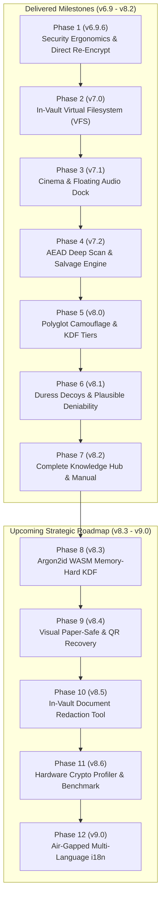

# 🚀 ZevSafe Future Roadmap & Architecture Master Plan

> **Authoritative Future Specifications, Milestones & Engineering Blueprint**  
> **Ecosystem:** `zevsafe` (Web PWA & Core Stream Cryptography)  
> **Status:** Active Reference & Execution Plan  
> **Last Updated:** November 2, 2026

---

## 🎯 Executive Vision

ZevSafe is a 100% client-side, zero-knowledge encryption suite designed to eliminate reliance on centralized cloud providers, servers, telemetry, and unencrypted local temp files. 

The primary vision of the **Next Generation ZevSafe** is to evolve from an *encrypted archive viewer* into a **full-featured, zero-footprint ephemeral encrypted virtual workspace**—allowing users to create, edit, organize, audit, and securely re-seal their most sensitive files with zero disk exposure and unmatched performance.

---

## 🗺️ Master Release Roadmap

---

## 📋 Detailed Completed Milestones (v6.9 – v8.2)

### Phase 1: Security Ergonomics & Direct In-Place Re-Encryption (v6.9.6) [COMPLETED]
- Built-in CSPRNG Diceware generator (770+ wordlist, 77+ bits Shannon entropy).
- Auto-lock inactivity timer protocol with TypedArray `.fill(0)` buffer zeroization.
- Direct in-place re-encryption from memory without intermediate unencrypted ZIP extraction.

### Phase 2: Complete In-Vault Virtual Filesystem (v7.0) [COMPLETED]
- Decrypted Explorer lifecycle: Add files/folders via Drag & Drop or picker, in-place file deletion, and path renaming.
- Safe client-side Markdown rendering with live editor toggle (`.md` preview, code highlights, checkboxes).

### Phase 3: Adaptive Streaming & Media Optimization (v7.1) [COMPLETED]
- Floating Audio Mini-Player Dock: Decouples playback from modal views so users can listen to audio while browsing.
- Zero-RAM Blob URL lifecycle: Immediate URL revocation on stop/close.

### Phase 4: Vault Health, Diagnostics & Bit-Rot Verifier (v7.2) [COMPLETED]
- 5-point diagnostic scorecard certifying container framing, PBKDF2 rounds, and auth tags.
- Live chunk-by-chunk AEAD deep scan (`verifyAllVaultChunks`).
- Fault-tolerant partial salvage engine (`salvageVault`) isolating corrupted blocks and rescuing intact files.

### Phase 5: Post-Quantum Hardening & Forensic Camouflage (v8.0) [COMPLETED]
- Steganographic Polyglot Forensic Media Camouflage (JPEG `0xFF 0xD9`, PNG `IEND`, MP4 `moov` embedding).
- Zero-allocation sliding-window vault locator (`findPolyglotVaultOffset`).
- In-memory minimalist cover generator via canvas.
- Configurable PBKDF2-HMAC-SHA512 hardening tiers (600k, 1.2M, and 2.4M rounds).

### Phase 6: Duress Decoy Vaults & Plausible Deniability (v8.1.0) [COMPLETED]
- Dual-manifest architecture (`V3_FLAG_DURESS = 0x02`): Master Password (real files) vs Duress Password (decoy files).
- $\text{IND-CPA}$ indistinguishability: Unauthenticated envelope is indistinguishable from random noise.
- 1-click realistic decoy file generator (Travel itineraries, Italian recipes, household budget CSVs).

### Phase 7: Comprehensive Knowledge Hub & Service Manual (v8.2.0) [COMPLETED]
- Master Knowledge Hub (`/knowledge/`) with client-side live search, hotkeys (`/`, `Esc`), and security matrix.
- Dual-Perspective Architecture (🟢 Simple Step-by-Step Guides vs 🔵 Deep Technical Specifications) with `localStorage` persistence.
- 9 dedicated deep-dive service pages across all ZevSafe cryptographic subsystems.
- Precached in Service Worker `v53` for 100% offline air-gapped access.

---

## 🔮 Upcoming Engineering Milestones (v8.3 – v9.0)

### Phase 8: Argon2id WebAssembly Memory-Hard Key Derivation (v8.3.0)
*Target: Q4 2026 / Early 2027*

1. **Memory-Hard Password Hashing:**
   - Integrate an ultra-lightweight (~30 KB) compiled WebAssembly module for **Argon2id** (winner of the Password Hashing Competition).
   - Parameters: Memory cost $m = 64\text{ MB}$, time iterations $t = 3$, parallelism degree $p = 4$.
   - **GPU & ASIC Immunity:** Because Argon2id requires 64 MB of dedicated RAM per hash thread, parallelized GPU cluster attacks and ASIC dictionary crackers are economically and architecturally neutralized.
2. **Adaptive Fallback Engine:**
   - Evaluates WebAssembly and memory availability. Gracefully defaults to PBKDF2-SHA512 (2.4M tier) on memory-restricted legacy environments.
3. **Container Header Integration:**
   - Utilizes container flag bit 2 (`0x04`) in byte 5 of the 57-byte header to signal Argon2id KDF parameters.

---

### Phase 9: Visual Paper-Safe & QR Code Emergency Recovery Sheet (v8.4.0)
*Target: Q1 2027*

1. **Air-Gapped Printable Recovery Sheet:**
   - Upgrades the plain-text recovery sheet into an elegant, printable visual PDF / HTML sheet formatted for standard paper safes and safety deposit boxes.
2. **Cryptographic QR Code Embedding:**
   - Generates an offline vector QR code encoding vault metadata: master salt fingerprint (hex), PBKDF2/Argon2id parameters, keyfile SHA-256 digest, and an optional user-defined hint string.
3. **Camera & Image Drop QR Scanner:**
   - In-browser optical QR scanner using the native `BarcodeDetector` API (with client-side fallback). Scanning the paper sheet automatically populates the vault's exact cryptographic configuration during unlocking with zero manual typing.

---

### Phase 10: In-Vault Document Redaction & Privacy Masking Tool (v8.5.0)
*Target: Q2 2027*

1. **Zero-Export In-Browser Visual Redaction:**
   - Integrated directly into the Decrypted Image Lightbox modal for photos, identity cards, medical scans, and PDF page screenshots.
2. **Irreversible Pixel Overwriting:**
   - Allows users to draw solid black redaction rectangles over sensitive PII (Social Security Numbers, passport MRZ lines, credit card digits, home addresses).
   - Redactions are burned directly into the underlying bitmap canvas before saving—not CSS overlays—preventing layer-peeling forensic recovery.
3. **Direct In-Place Re-Encryption:**
   - Replaced image buffer is written directly to `activeSession.overlayFiles` and re-encrypted back into the `.zev` vault with 0 unredacted remnants saved to disk.

---

### Phase 11: Browser Cryptographic Benchmark & Hardware Profiler (v8.6.0)
*Target: Q3 2027*

1. **Built-in Hardware Cryptographic Benchmark:**
   - A dedicated diagnostic test suite embedded directly within the Knowledge Hub and Settings panel.
2. **Performance Metrics:**
   - **AES-256-GCM Streaming Throughput:** Measures sustained MB/s across Web Worker pools.
   - **KDF Latency Profile:** Benchmarks 600k, 1.2M, and 2.4M PBKDF2 iterations and Argon2id execution times on the user's CPU.
   - **Memory Pressure Boundary:** Determines optimal chunk buffering limits and hardware concurrency recommendations for the active browser.
3. **Interactive Visual Scorecard:**
   - Displays hardware tier ranking (e.g. "Desktop High-Compute", "Balanced Laptop", "Mobile Power-Saver").

---

### Phase 12: Offline Multi-Language Internationalization (i18n) (v9.0.0)
*Target: 2027*

1. **100% Offline Multi-Language Architecture:**
   - Zero-network internationalization framework supporting: English, Spanish (`es`), French (`fr`), German (`de`), Japanese (`ja`), and Chinese (`zh`).
2. **Precached Language Bundles:**
   - Static lightweight JSON translation dictionaries precached in the Service Worker app shell.
3. **Dynamic Seamless Language Switcher:**
   - 1-click language switcher in the navbar that re-renders all UI strings, toast notifications, Knowledge Hub guides, and error dialogs instantly without page reload.

---

## 🔒 Security Principles Maintained
- **100% Client-Side:** No external network requests, zero telemetry, no third-party CDNs.
- **Air-Gapped Operation:** All new features must work seamlessly in airplane mode or disconnected networks.
- **Strict RAM Ceilings:** Peak memory delta must remain bounded $< 150\text{ MB}$ regardless of vault or file size.
- **Universal Zeroization:** All sensitive buffers and handles must be scrubbed with `.fill(0)` on session lock.
