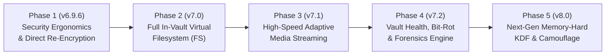

# 🚀 ZevSafe Future Roadmap & Architecture Master Plan

> **Authoritative Future Specifications, Milestones & Engineering Blueprint**  
> **Ecosystem:** `zevsafe` (Web PWA & Core Stream Cryptography)  
> **Status:** Active Reference & Execution Plan  
> **Last Updated:** November 2, 2026

---

## 🎯 Executive Vision

ZevSafe is a 100% client-side, zero-knowledge encryption suite designed to eliminate reliance on centralized cloud providers, servers, telemetry, and unencrypted local temp files. 

The primary vision of the **Next Generation ZevSafe** is to evolve from an *encrypted archive viewer* into a **full-featured, zero-footprint ephemeral encrypted virtual workspace**—allowing users to create, edit, organize, audit, and securely re-seal their most sensitive files with zero disk exposure and unmatched performance.

---

## 🗺️ Master Release Roadmap

---

## 📋 Detailed Milestone Breakdown

### Phase 1: Security Ergonomics & Direct In-Place Re-Encryption (v6.9.6)
*Target: Immediate Execution*

1. **Built-in CSPRNG Password & Diceware Passphrase Generator:**
   - **Diceware Engine:** High-entropy 4–6 word passphrases derived from an air-gapped, curated 7,776-word EFF-style wordlist using `crypto.getRandomValues`.
   - **Alphanumeric Random Generator:** 16–32 character cryptographically random tokens with custom character sets (symbols, numbers, uppercase).
   - **1-Click Synchronization:** Auto-populates both "Password or PIN" and "Confirm Password" fields and recalculates live entropy strength.
2. **Auto-Lock Inactivity Timer Protocol:**
   - Configurable idle timeout in Vault Explorer header: `[Disabled / 5 min / 15 min / 30 min]`.
   - Reset on pointer, keyboard, scroll, and touch interactions.
   - Automatic execution of `lockVaultSession()` with full zeroization (`.fill(0)` on keys, chunk caches, DOM fields, and object URL revocations).
3. **In-Vault "Save & Re-Encrypt to `.zev`" (Direct In-Place Vault Export):**
   - Adds `🔒 Re-Encrypt (.zev)` in Vault Explorer.
   - Takes modified files (`editedFiles` overlay) and existing catalog items, streaming a brand new `ZV3\0` container using the active session key or password without requiring intermediate unencrypted ZIP extraction.

---

### Phase 2: Complete In-Vault Virtual Filesystem (v7.0)
*Target: Q1 2027*

1. **Full File & Folder Lifecycle in Decrypted Explorer:**
   - **Add Files / Upload:** Drag-and-drop or file picker to upload external documents, pictures, or folders directly into `explorerCurrentDir`.
   - **In-Vault File & Folder Deletion:** Soft-delete entries from the session catalog and overlay.
   - **In-Vault Renaming & Moving:** Rename or move files across directories within the vault.
2. **Live Markdown Rendering (`.md` Mode):**
   - Seamless toggle between Monospace Raw Code, Interactive Text Editor, and Formatted HTML Markdown in `#vault-text-modal`.
   - Zero-dependency client-side parser supporting tables, checklists, code highlights, and blockquotes.

---

### Phase 3: Adaptive Streaming & Media Optimization (v7.1)
*Target: Q2 2027*

1. **Smart Media Compression Bypass (5× Throughput Boost):**
   - Heuristic pre-filtering in `StreamPacker`: Detects already-compressed mime types (`.mp4`, `.mkv`, `.mp3`, `.jpg`, `.png`, `.webp`, `.zip`, `.gz`).
   - Automatically stores uncompressed chunks (`STORE` mode) rather than wasting CPU cycles re-running Deflate compression.
2. **Docked Audio Mini-Player:**
   - Audio files can be minimized to a persistent bottom dock bar so users can listen to encrypted audio notes, lectures, or music while navigating the vault tree.

---

### Phase 4: Vault Health, Diagnostics & Bit-Rot Verifier (v7.2)
*Target: Q3 2027*

1. **Cryptographic Integrity & Bit-Rot Verification:**
   - Dedicated "Verify Vault" action verifying the 57-byte header, chunk framing, and AES-GCM 16-byte authentication tags across all chunks without extracting data to RAM or disk.
   - Comprehensive diagnostic scorecard: Container integrity, PBKDF2 iteration count, compression ratio, chunk health, and salt entropy.
2. **Fault-Tolerant Partial Recovery:**
   - Ability to recover intact chunks from damaged `.zev` archives even if a specific chunk was corrupted by disk hardware failure.

---

### Phase 5: Post-Quantum & Forensic Camouflage (v8.0)
*Target: 2027–2028*

1. **Argon2id Memory-Hard Key Derivation:**
   - Progressive enhancement introducing Argon2id via lightweight WebAssembly for hardware-brute-force immunity.
2. **Steganographic Polyglot Vault Camouflage:**
   - Appending valid `ZV3\0` containers to authentic image or media files (polyglots) so vaults appear as standard photos or videos in generic file viewers.

---

## 🔒 Security Principles Maintained
- **100% Client-Side:** No external network requests, zero telemetry, no third-party CDNs.
- **Air-Gapped Operation:** All new features must work seamlessly in airplane mode or disconnected networks.
- **Strict RAM Ceilings:** Peak memory delta must remain bounded $< 150\text{ MB}$ regardless of vault or file size.
- **Universal Zeroization:** All sensitive buffers and handles must be scrubbed with `.fill(0)` on session lock.

### Phase 6: Duress Decoy Vaults & Plausible Deniability (v8.1.0) [COMPLETED]
*Delivered: November 2, 2026*

1. **Dual-Manifest Plausible Deniability Architecture:**
   - Single `.zev` container supporting two independent passwords: Master Password (real files) vs Duress Password (decoy files).
   - Unauthenticated manifests are mathematically indistinguishable from random AES static.
2. **Realistic Decoy Generator:**
   - 1-click generation of believable travel itineraries, packing lists, Italian recipes, and household budgets.

### Phase 7: Comprehensive Knowledge Hub & Service Manual (v8.2.0) [COMPLETED]
*Delivered: November 2, 2026*

1. **Master Knowledge Hub (`/knowledge/`):**
   - Instant client-side search across all 9 core services, security invariants matrix, quick-reference cheat sheets, and keyboard navigation (`/` to search, `Esc` to clear).
2. **Dual-Perspective Architecture (Simple vs Deep Technical):**
   - 2-way / 3-way toggle between 🟢 *Simple Step-by-Step User Guides* and 🔵 *Deep Cryptographic Specifications* (byte-level binary tables, Web Crypto API parameters, mathematical formulas, threat models). Preference persisted in `localStorage`.
3. **Dedicated Deep-Dive Service Manuals:**
   - 9 dedicated service manuals covering Core Streaming Vault, Virtual Filesystem, Duress Decoys, Polyglot Camouflage, Vault Health & Salvage, Media Cinema Deck & Floating Dock, Passwords & Auto-Lock Protocol, Key Derivation & 2FA Keyfiles, and Multi-Tier Mobile Streaming Pipeline.
4. **Offline Air-Gapped Precaching:**
   - Precached in Service Worker `v53` for 100% offline availability in airplane mode.
